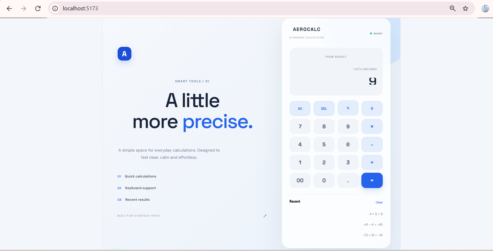

# Ex04 Simple Calculator - React Project
## Date:24-11-2026
## Name : Ans Nerling Emima S
## Reg No :212224040027

## AIM
To  develop a Simple Calculator using React.js with clean and responsive design, ensuring a smooth user experience across different screen sizes.

## ALGORITHM
### STEP 1
Create a React App.

### STEP 2
Open a terminal and run:
  <ul><li>npx create-react-app simple-calculator</li>
  <li>cd simple-calculator</li>
  <li>npm start</li></ul>

### STEP 3
Inside the src/ folder, create a new file Calculator.js and define the basic structure.

### STEP 4
Plan the UI: Display screen, number buttons (0-9), operators (+, -, *, /), clear (C), and equal (=).

### STEP 5
Create a new file Calculator.css in src/ and add the styling.

### STEP 6
Open src/App.js and modify it.

### STEP 7
Start the development server.
  npm start

### STEP 8
Open http://localhost:3000/ in the browser.

### STEP 9
Test the calculator by entering numbers and operations.

### STEP 10
Fix styling issues and refine content placement.

### STEP 11
Deploy the website.

### STEP 12
Upload to GitHub Pages for free hosting.

## PROGRAM
App.jsx
```

import { useState, useEffect } from "react";
import "./App.css";

function App() {
  const [display, setDisplay] = useState("0");
  const [previous, setPrevious] = useState(null);
  const [operator, setOperator] = useState(null);
  const [waiting, setWaiting] = useState(false);
  const [history, setHistory] = useState([]);

  const formatNumber = (number) => {
    if (!Number.isFinite(number)) return "Error";
    return String(Number(number.toPrecision(12)));
  };

  const calculate = (a, b, op) => {
    switch (op) {
      case "+":
        return a + b;
      case "-":
        return a - b;
      case "×":
        return a * b;
      case "÷":
        return b === 0 ? "Error" : a / b;
      default:
        return b;
    }
  };

  const inputDigit = (digit) => {
    if (display === "Error") {
      setDisplay(digit);
      setWaiting(false);
      return;
    }

    if (waiting) {
      setDisplay(digit);
      setWaiting(false);
    } else {
      setDisplay(display === "0" ? digit : display + digit);
    }
  };

  const inputDecimal = () => {
    if (display === "Error" || waiting) {
      setDisplay("0.");
      setWaiting(false);
      return;
    }

    if (!display.includes(".")) {
      setDisplay(display + ".");
    }
  };

  const clearAll = () => {
    setDisplay("0");
    setPrevious(null);
    setOperator(null);
    setWaiting(false);
  };

  const deleteLast = () => {
    if (display === "Error" || waiting) {
      setDisplay("0");
      setWaiting(false);
      return;
    }

    setDisplay(display.length > 1 ? display.slice(0, -1) : "0");
  };

  const chooseOperator = (nextOperator) => {
    if (display === "Error") return;

    const value = Number(display);

    if (operator && !waiting) {
      const result = calculate(previous, value, operator);

      if (result === "Error") {
        setDisplay("Error");
        setPrevious(null);
        setOperator(null);
        setWaiting(true);
        return;
      }

      setDisplay(formatNumber(result));
      setPrevious(result);
    } else {
      setPrevious(value);
    }

    setOperator(nextOperator);
    setWaiting(true);
  };

  const performCalculation = () => {
    if (
      operator === null ||
      previous === null ||
      display === "Error" ||
      waiting
    ) return;

    const second = Number(display);
    const result = calculate(previous, second, operator);

    setHistory((items) =>
      [`${previous} ${operator} ${second} = ${formatNumber(result)}`, ...items].slice(0, 4)
    );

    setDisplay(formatNumber(result));
    setPrevious(null);
    setOperator(null);
    setWaiting(true);
  };

  const percentage = () => {
    if (display === "Error") return;
    setDisplay(formatNumber(Number(display) / 100));
    setWaiting(false);
  };

  useEffect(() => {
    const handleKeyDown = (event) => {
      const key = event.key;

      if (/^[0-9]$/.test(key)) inputDigit(key);
      else if (key === ".") inputDecimal();
      else if (key === "+") chooseOperator("+");
      else if (key === "-") chooseOperator("-");
      else if (key === "*") chooseOperator("×");
      else if (key === "/") {
        event.preventDefault();
        chooseOperator("÷");
      } else if (key === "Enter" || key === "=") {
        performCalculation();
      } else if (key === "Backspace") {
        deleteLast();
      } else if (key === "Escape") {
        clearAll();
      } else if (key === "%") {
        percentage();
      }
    };

    window.addEventListener("keydown", handleKeyDown);
    return () => window.removeEventListener("keydown", handleKeyDown);
  });

  const buttons = [
    { label: "AC", type: "utility", action: clearAll },
    { label: "DEL", type: "utility", action: deleteLast },
    { label: "%", type: "utility", action: percentage },
    { label: "÷", type: "operator", action: () => chooseOperator("÷") },

    { label: "7", action: () => inputDigit("7") },
    { label: "8", action: () => inputDigit("8") },
    { label: "9", action: () => inputDigit("9") },
    { label: "×", type: "operator", action: () => chooseOperator("×") },

    { label: "4", action: () => inputDigit("4") },
    { label: "5", action: () => inputDigit("5") },
    { label: "6", action: () => inputDigit("6") },
    { label: "-", type: "operator", action: () => chooseOperator("-") },

    { label: "1", action: () => inputDigit("1") },
    { label: "2", action: () => inputDigit("2") },
    { label: "3", action: () => inputDigit("3") },
    { label: "+", type: "operator", action: () => chooseOperator("+") },

    {
      label: "00",
      action: () => {
        inputDigit("0");
        inputDigit("0");
      },
    },
    { label: "0", action: () => inputDigit("0") },
    { label: ".", action: inputDecimal },
    { label: "=", type: "equals", action: performCalculation },
  ];

  return (
    <main className="app-container">
      <div className="ambient ambient-one"></div>
      <div className="ambient ambient-two"></div>

      <div className="workspace">
        <aside className="intro-panel">
          <div className="logo-mark">A</div>

          <p className="eyebrow">SMART TOOLS / 01</p>
          <h1>
            A little
            <br />
            more <span>precise.</span>
          </h1>

          <p className="intro-description">
            A simple space for everyday calculations.
            Designed to feel clear, calm and effortless.
          </p>

          <div className="feature-list">
            <div>
              <span className="feature-number">01</span>
              <span>Quick calculations</span>
            </div>
            <div>
              <span className="feature-number">02</span>
              <span>Keyboard support</span>
            </div>
            <div>
              <span className="feature-number">03</span>
              <span>Recent results</span>
            </div>
          </div>

          <div className="intro-bottom">
            <span>BUILT FOR EVERYDAY MATH</span>
            <span>↗</span>
          </div>
        </aside>

        <section className="calculator">
          <header className="calc-header">
            <div>
              <p className="calc-label">AEROCALC</p>
              <p className="calc-subtitle">STANDARD CALCULATOR</p>
            </div>
            <div className="live-indicator">
              <span></span> READY
            </div>
          </header>

          <div className="display-section">
            <p className="display-label">YOUR RESULT</p>

            <div className="expression">
              {previous !== null && operator
                ? `${formatNumber(previous)} ${operator}`
                : "Let's calculate"}
            </div>

            <div className="display">
              <span>{display}</span>
            </div>
          </div>

          <div className="button-grid">
            {buttons.map((button) => (
              <button
                key={button.label}
                className={`calc-button ${button.type || ""} ${
                  button.type === "operator" && operator === button.label
                    ? "active"
                    : ""
                }`}
                onClick={button.action}
                aria-label={button.label}
              >
                {button.label}
              </button>
            ))}
          </div>

          <section className="history-section">
            <div className="history-heading">
              <h2>Recent</h2>
              <button onClick={() => setHistory([])}>Clear</button>
            </div>

            {history.length === 0 ? (
              <p className="empty-history">Your results will appear here.</p>
            ) : (
              history.map((item, index) => (
                <p className="history-item" key={index}>{item}</p>
              ))
            )}
          </section>
        </section>
      </div>

      <footer className="page-footer">
        <div>
          <span className="footer-label">DESIGNED & DEVELOPED BY</span>
          <strong>Ans Nerling Emima S</strong>
        </div>

        <div className="footer-register">
          <span className="footer-label">212224040027</span>
          <strong>212224040027</strong>
        </div>

        <span className="footer-copyright">AEROCALC © 2026</span>
      </footer>
    </main>
  );
}

export default App;
```
App.css
```
  
@import url('https://fonts.googleapis.com/css2?family=DM+Sans:wght@400;500;600;700&family=Space+Grotesk:wght@400;500;600;700&display=swap');

* {
  margin: 0;
  padding: 0;
  box-sizing: border-box;
}

body {
  font-family: 'DM Sans', sans-serif;
  background: #f3f6fb;
  color: #182337;
}

.app-container {
  min-height: 100vh;
  position: relative;
  overflow: hidden;
  padding: 55px 25px 30px;
  background:
    linear-gradient(135deg, #f5f8fc 0%, #eaf1fa 100%);
}

.ambient {
  position: absolute;
  border-radius: 50%;
  filter: blur(2px);
  pointer-events: none;
}

.ambient-one {
  width: 420px;
  height: 420px;
  background: #d4e7ff;
  top: -180px;
  right: -100px;
}

.ambient-two {
  width: 300px;
  height: 300px;
  background: #d8f4f0;
  bottom: -130px;
  left: -100px;
}

.workspace {
  position: relative;
  z-index: 1;
  max-width: 1050px;
  margin: auto;
  display: grid;
  grid-template-columns: 1fr 410px;
  gap: 35px;
  align-items: center;
}

.intro-panel {
  padding: 30px 20px;
  min-height: 650px;
  display: flex;
  flex-direction: column;
}

.logo-mark {
  width: 52px;
  height: 52px;
  display: grid;
  place-items: center;
  border-radius: 17px;
  background: #1d4ed8;
  color: white;
  font-family: 'Space Grotesk', sans-serif;
  font-size: 28px;
  font-weight: 700;
  box-shadow: 0 10px 25px #1d4ed833;
}

.eyebrow {
  margin-top: 65px;
  color: #64809b;
  font-size: 11px;
  font-weight: 700;
  letter-spacing: 2px;
}

.intro-panel h1 {
  margin-top: 18px;
  font-family: 'Space Grotesk', sans-serif;
  font-size: clamp(45px, 6vw, 76px);
  line-height: 1.05;
  letter-spacing: -3px;
  color: #182337;
}

.intro-panel h1 span {
  color: #2563eb;
}

.intro-description {
  max-width: 390px;
  margin-top: 25px;
  color: #718096;
  font-size: 15px;
  line-height: 1.8;
}

.feature-list {
  margin-top: 45px;
  display: grid;
  gap: 18px;
}

.feature-list div {
  display: flex;
  align-items: center;
  gap: 15px;
  color: #43556b;
  font-size: 13px;
  font-weight: 600;
}

.feature-number {
  color: #2563eb;
  font-family: 'Space Grotesk', sans-serif;
  font-size: 11px;
}

.intro-bottom {
  display: flex;
  justify-content: space-between;
  align-items: center;
  margin-top: auto;
  padding-top: 35px;
  color: #8ca0b4;
  font-size: 10px;
  letter-spacing: 1.5px;
}

.intro-bottom span:last-child {
  color: #2563eb;
  font-size: 20px;
}

.calculator {
  padding: 28px;
  border-radius: 30px;
  background: rgba(255, 255, 255, 0.82);
  border: 1px solid white;
  box-shadow: 0 30px 90px #56718b26;
  backdrop-filter: blur(20px);
}

.calc-header {
  display: flex;
  justify-content: space-between;
  align-items: center;
  margin-bottom: 25px;
}

.calc-label {
  font-family: 'Space Grotesk', sans-serif;
  font-size: 18px;
  font-weight: 700;
  letter-spacing: 2px;
}

.calc-subtitle {
  margin-top: 5px;
  color: #94a3b8;
  font-size: 9px;
  letter-spacing: 1.5px;
}

.live-indicator {
  display: flex;
  align-items: center;
  gap: 7px;
  color: #64748b;
  font-size: 9px;
  font-weight: 700;
  letter-spacing: 1px;
}

.live-indicator span {
  width: 7px;
  height: 7px;
  border-radius: 50%;
  background: #22c55e;
}

.display-section {
  padding: 22px;
  border-radius: 22px;
  background: #f1f5fa;
  margin-bottom: 20px;
}

.display-label {
  color: #91a1b5;
  font-size: 10px;
  font-weight: 700;
  letter-spacing: 1.5px;
}

.expression {
  margin-top: 20px;
  color: #8b9bb0;
  font-size: 13px;
  text-align: right;
  min-height: 18px;
}

.display {
  display: flex;
  justify-content: flex-end;
  align-items: center;
  min-height: 65px;
  overflow: hidden;
}

.display span {
  color: #17243a;
  font-family: 'Space Grotesk', sans-serif;
  font-size: clamp(35px, 8vw, 49px);
  font-weight: 600;
  white-space: nowrap;
  overflow-x: auto;
  scrollbar-width: none;
}

.button-grid {
  display: grid;
  grid-template-columns: repeat(4, 1fr);
  gap: 10px;
}

.calc-button {
  height: 58px;
  border: none;
  border-radius: 17px;
  background: #f1f5fa;
  color: #334155;
  font-family: 'Space Grotesk', sans-serif;
  font-size: 20px;
  font-weight: 600;
  cursor: pointer;
  transition: 0.18s ease;
}

.calc-button:hover {
  background: #e1eaf5;
  transform: translateY(-2px);
}

.calc-button:active {
  transform: scale(0.94);
}

.calc-button.utility {
  background: #e4edfb;
  color: #2563eb;
  font-size: 13px;
}

.calc-button.operator {
  background: #e4edfb;
  color: #2563eb;
  font-size: 23px;
}

.calc-button.operator.active,
.calc-button.operator:hover {
  background: #2563eb;
  color: white;
}

.calc-button.equals {
  background: #2563eb;
  color: white;
  box-shadow: 0 8px 20px #2563eb33;
}

.calc-button.equals:hover {
  background: #1d4ed8;
}

.history-section {
  margin-top: 23px;
  padding-top: 18px;
  border-top: 1px solid #e8edf4;
}

.history-heading {
  display: flex;
  justify-content: space-between;
  align-items: center;
  margin-bottom: 12px;
}

.history-heading h2 {
  font-size: 13px;
  font-weight: 700;
}

.history-heading button {
  border: none;
  background: transparent;
  color: #2563eb;
  font-size: 11px;
  cursor: pointer;
}

.empty-history {
  color: #9aa9ba;
  font-size: 12px;
}

.history-item {
  padding: 7px 0;
  color: #64748b;
  font-size: 12px;
  text-align: right;
  overflow-wrap: anywhere;
}

.page-footer {
  position: relative;
  z-index: 1;
  max-width: 1050px;
  margin: 40px auto 0;
  padding: 22px 20px;
  border-top: 1px solid #dbe4ef;
  display: flex;
  align-items: center;
  justify-content: space-between;
  gap: 20px;
}

.page-footer div {
  display: grid;
  gap: 6px;
}

.footer-label {
  color: #8a9bb0;
  font-size: 9px;
  font-weight: 700;
  letter-spacing: 1.5px;
}

.page-footer strong {
  color: #26364d;
  font-family: 'Space Grotesk', sans-serif;
  font-size: 14px;
}

.footer-copyright {
  color: #8a9bb0;
  font-size: 10px;
  letter-spacing: 1px;
}

@media (max-width: 850px) {
  .workspace {
    grid-template-columns: 1fr;
    max-width: 500px;
  }

  .intro-panel {
    min-height: auto;
    padding: 15px 5px;
  }

  .eyebrow {
    margin-top: 35px;
  }

  .intro-panel h1 {
    font-size: 54px;
  }

  .feature-list {
    margin-top: 25px;
  }

  .intro-bottom {
    display: none;
  }
}

@media (max-width: 520px) {
  .app-container {
    padding: 25px 12px;
  }

  .calculator {
    padding: 20px;
    border-radius: 24px;
  }

  .page-footer {
    flex-wrap: wrap;
    padding: 20px 5px;
  }

  .calc-button {
    height: 55px;
    border-radius: 14px;
  }

  .button-grid {
    gap: 8px;
  }
}
```
index.css
```
:root {
  --text: #6b6375;
  --text-h: #08060d;
  --bg: #fff;
  --border: #e5e4e7;
  --code-bg: #f4f3ec;
  --accent: #aa3bff;
  --accent-bg: rgba(170, 59, 255, 0.1);
  --accent-border: rgba(170, 59, 255, 0.5);
  --social-bg: rgba(244, 243, 236, 0.5);
  --shadow:
    rgba(0, 0, 0, 0.1) 0 10px 15px -3px, rgba(0, 0, 0, 0.05) 0 4px 6px -2px;

  --sans: system-ui, 'Segoe UI', Roboto, sans-serif;
  --heading: system-ui, 'Segoe UI', Roboto, sans-serif;
  --mono: ui-monospace, Consolas, monospace;

  font: 18px/145% var(--sans);
  letter-spacing: 0.18px;
  color-scheme: light dark;
  color: var(--text);
  background: var(--bg);
  font-synthesis: none;
  text-rendering: optimizeLegibility;
  -webkit-font-smoothing: antialiased;
  -moz-osx-font-smoothing: grayscale;

  @media (max-width: 1024px) {
    font-size: 16px;
  }
}

@media (prefers-color-scheme: dark) {
  :root {
    --text: #9ca3af;
    --text-h: #f3f4f6;
    --bg: #16171d;
    --border: #2e303a;
    --code-bg: #1f2028;
    --accent: #c084fc;
    --accent-bg: rgba(192, 132, 252, 0.15);
    --accent-border: rgba(192, 132, 252, 0.5);
    --social-bg: rgba(47, 48, 58, 0.5);
    --shadow:
      rgba(0, 0, 0, 0.4) 0 10px 15px -3px, rgba(0, 0, 0, 0.25) 0 4px 6px -2px;
  }

  #social .button-icon {
    filter: invert(1) brightness(2);
  }
}

body {
  margin: 0;
}

#root {
  width: 1126px;
  max-width: 100%;
  margin: 0 auto;
  text-align: center;
  border-inline: 1px solid var(--border);
  min-height: 100svh;
  display: flex;
  flex-direction: column;
  box-sizing: border-box;
}

h1,
h2 {
  font-family: var(--heading);
  font-weight: 500;
  color: var(--text-h);
}

h1 {
  font-size: 56px;
  letter-spacing: -1.68px;
  margin: 32px 0;
  @media (max-width: 1024px) {
    font-size: 36px;
    margin: 20px 0;
  }
}
h2 {
  font-size: 24px;
  line-height: 118%;
  letter-spacing: -0.24px;
  margin: 0 0 8px;
  @media (max-width: 1024px) {
    font-size: 20px;
  }
}
p {
  margin: 0;
}

code,
.counter {
  font-family: var(--mono);
  display: inline-flex;
  border-radius: 4px;
  color: var(--text-h);
}

code {
  font-size: 15px;
  line-height: 135%;
  padding: 4px 8px;
  background: var(--code-bg);
}
```
main.jsx
```
import { StrictMode } from 'react'
import { createRoot } from 'react-dom/client'
import './index.css'
import App from './App.jsx'

createRoot(document.getElementById('root')).render(
  <StrictMode>
    <App />
  </StrictMode>,
)
```


## OUTPUT



## RESULT
The program for developing a simple calculator in React.js is executed successfully.
